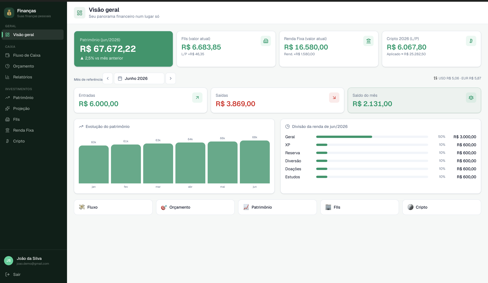
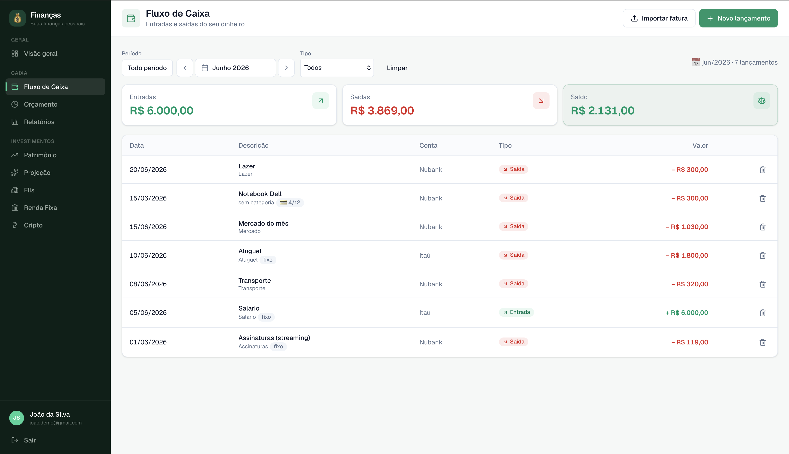
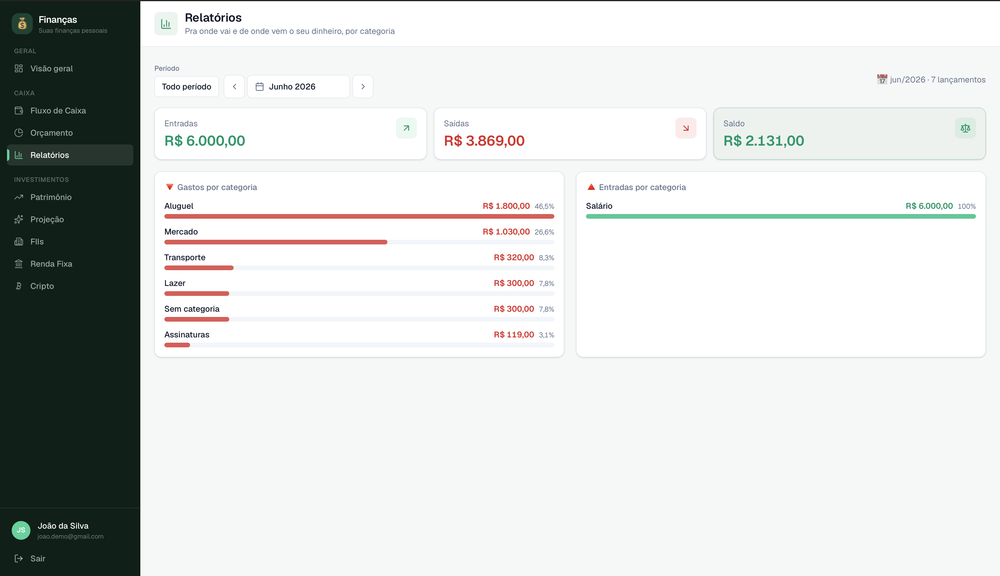
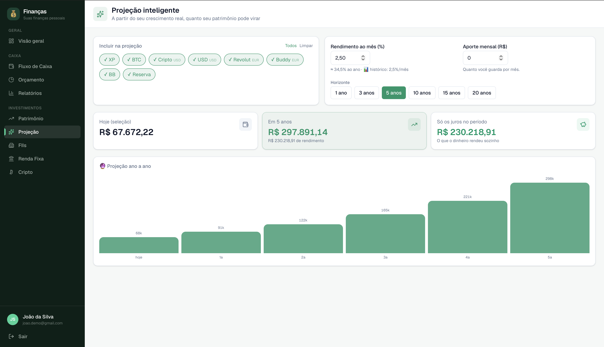
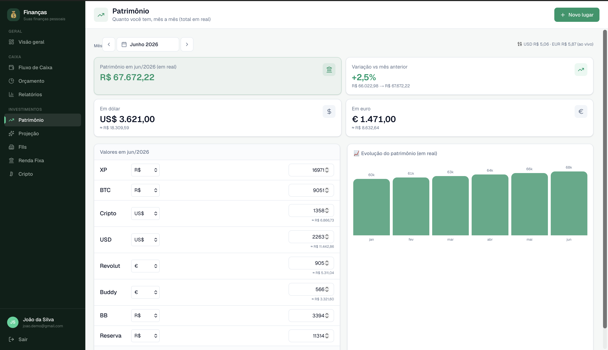

# Finanças Pessoais

App de finanças pessoais com fluxo de caixa, orçamento, patrimônio e investimentos. É multi-tenant: cada usuário só enxerga os próprios dados.

Comecei como projeto de estudo de backend (venho de QA e front-end). O foco é arquitetura em camadas, validação de ponta a ponta e segurança com Row Level Security no Postgres.

**Acesso fechado.** A instância publicada não aceita cadastro (signup desligado no Supabase); o uso é pessoal. Para explorar localmente, use um projeto Supabase de teste, nunca o de produção, e rode `npm run seed:demo -- --sim`. O script cria um usuário de demonstração com dados fictícios e mostra o login e uma senha aleatória no terminal.

## Funcionalidades

- **Plano de contas único:** grupos (receita, despesa, investimento), subgrupos opcionais e categorias. Lançamentos, recorrências, controle anual e relatórios usam o mesmo plano.
- **Lançamentos:** entradas e saídas do mês, compras parceladas e importação de fatura OFX/CSV sem duplicar.
- **Recorrências:** receitas e despesas fixas (salário, aluguel, assinaturas) que podem ser pausadas, reajustadas a partir de um mês e finalizadas. Cada mês vira uma previsão que você confirma (pago ou recebido), podendo ajustar o valor.
- **Controle anual:** os 12 meses por categoria, comparando planejado (recorrências ou valor digitado) com realizado (lançamentos). Cada grupo pode ter meta em % da receita.
- **Orçamento:** fatias livres (nome e % das entradas do mês). Cada saída é lançada numa fatia, que mostra quanto já foi usado e quanto resta.
- **Patrimônio:** foto mensal por lugar, em BRL, USD ou EUR com cotação ao vivo. Ações, FIIs, renda fixa, cripto e consórcios entram sozinhos; o resto é manual.
- **Projeção:** juros compostos a partir do crescimento histórico (comparando só os mesmos itens mês a mês), com aporte mensal e horizonte de 1 a 20 anos.
- **Investimentos:** ações e FIIs com cotação ao vivo (Yahoo Finance), renda fixa, cripto por corretora e consórcios com reajuste de parcela.
- **Interface:** tema claro, escuro ou do sistema, e layout adaptado para celular.

## Telas

Capturas com dados fictícios (usuário de demonstração).

| Visão geral | Lançamentos |
|---|---|
|  |  |

| Relatórios (gastos por categoria) | Projeção |
|---|---|
|  |  |

| Patrimônio |
|---|
|  |

## Stack

- Next.js 16 (App Router), React 19 e TypeScript, em um monolito
- Supabase: Postgres, Auth (cookies via `@supabase/ssr`) e RLS
- Tailwind 4 (tokens via `@theme`) com componentes no estilo shadcn
- Zod para validação e Vitest para os testes das funções puras

## Arquitetura

Todo módulo segue o mesmo caminho, do banco à tela:

```
migration (SQL + RLS)  →  schema (Zod)  →  repo (única camada que fala com o banco)
   →  service (regra de negócio, carimba o tenant)  →  rota (/api)  →  client (React)
```

- Os cálculos ficam em arquivos `*.calc.ts`, sem acesso a banco ou rede. Rodam igual no servidor e no navegador (prévia de parcelas, projeção) e têm testes.
- O repo não filtra por tenant. Quem isola os dados é o RLS no banco.

## Multi-tenancy e segurança

- Cada usuário é um tenant, criado automaticamente junto com a conta (gatilho `handle_new_user`). A conta nova começa vazia.
- O cadastro está desligado na instância publicada. As contas são criadas pelo administrador.
- Toda tabela tem RLS com políticas `tenant_id = current_tenant_id()`. Sem login, nada é acessível.
- As páginas são estáticas; os dados só saem pelas rotas `/api`, que exigem sessão. A sessão expira 12 horas após o login.
- A chave `service_role` fica só no servidor (cron de fechamento mensal), nunca no navegador nem no git.

## Rodando localmente

```bash
# 1. dependências
npm install

# 2. variáveis de ambiente (crie um projeto no Supabase e preencha)
#    NEXT_PUBLIC_SUPABASE_URL, NEXT_PUBLIC_SUPABASE_ANON_KEY, SUPABASE_SERVICE_ROLE_KEY
#    em um arquivo .env.local

# 3. migrations (no SQL Editor do Supabase, ou via psql)
#    aplique os arquivos em supabase/migrations/ em ordem

# 4. usuário + dados de demonstração (como o cadastro é fechado, é assim
#    que se cria o login pra testar). O login e a senha aparecem no terminal;
#    pra escolher a senha: DEMO_SENHA=suasenha npm run seed:demo -- --sim
npm run seed:demo -- --sim   # só em projeto Supabase de TESTE

# 5. sobe o app e entre com o login do demo
npm run dev
```

### Scripts

| Comando | Descrição |
|---|---|
| `npm run dev` | modo desenvolvimento |
| `npm test` | testes (Vitest) |
| `npm run build` | build de produção |
| `npm run seed:demo -- --sim` | cria o usuário de demonstração (só em projeto de teste) |
| `npm run backup` | dump do banco (`pg_dump`) |

---

Projeto de estudo. Não é recomendação de investimento.
